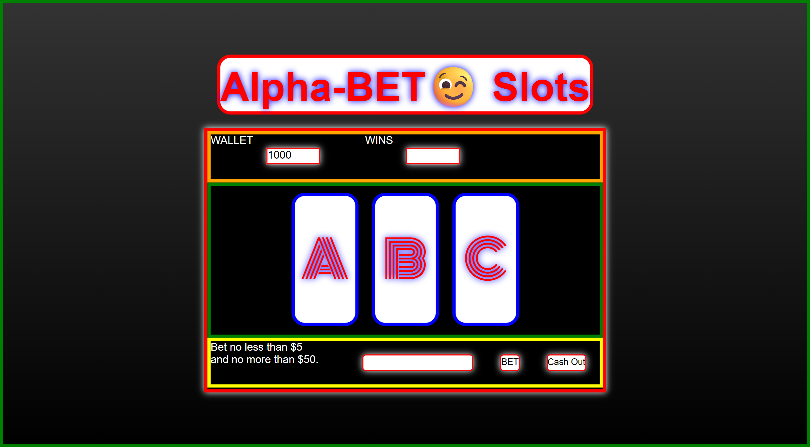

# 🎰 Alpha-BET Slot Machine

### Goal: Build a Simple Slot Machine

## Project Description

A slot machine game. Select your bet from 5 to 50 credits. Once you hit BET the reels will spin and award credits for 2/3 or 3/3 matching. Bets under 20 can win 20 credits for 2/3 match OR 100 credits for 3/3 match. Bets over 20 can win 50 for 2/3 match or 1000 for 3/3 match. Option to "Cash Out" and reset the game.  

## Tech Stack

- **HTML** 
- **CSS**
- **JavaScript**

## How to Run or View It

1. Clone or download the repository.
2. Open `index.html` in a browser or serve the project using a local development server.
3. Select a bet from 5 to 50 credits
4. Click *BET*
5. Reels will spin and award credits for 2/3 or 3/3 matching. 
6. Option to "Cash Out" and reset the game

## Screenshots and Demo

### Application Interface

.png)

The interface displays an input to add items to complete, each item then displays and has the option to be checked off as completed or completely deleted.
